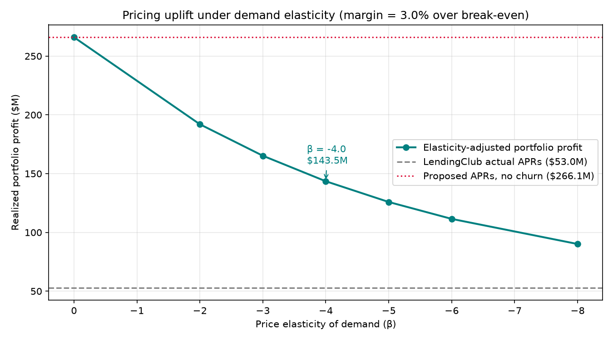
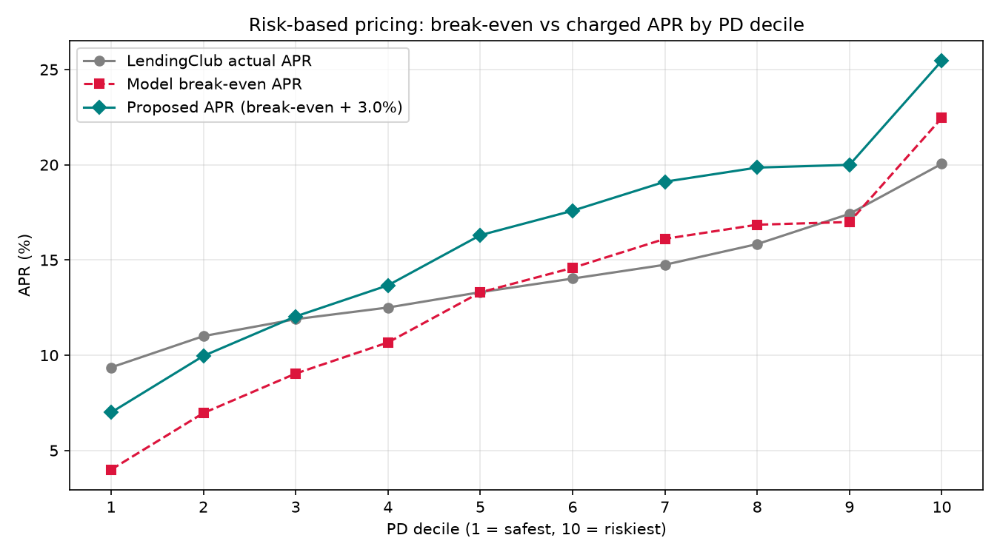
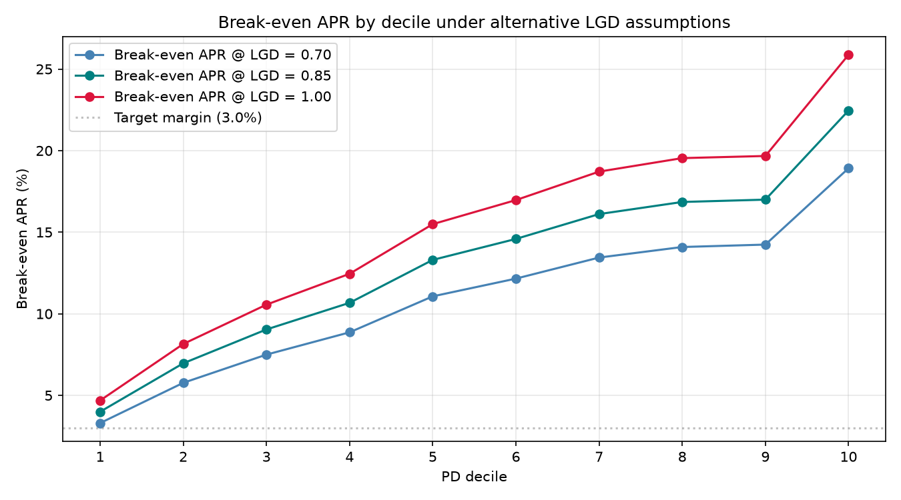
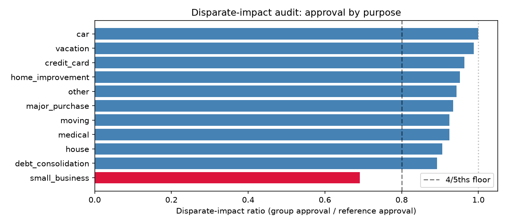

# Credit Risk Model — PD, Approval Cutoff, Risk-Based Pricing

A probability-of-default (PD) model on **2.26M LendingClub loans (2007–2018)** that goes beyond `roc_auc_score` to answer the two questions a lender actually cares about: **who do we approve, and what rate do we charge them.** Trained on borrower attributes only — grade, sub-grade, and the lender's own interest rate are deliberately excluded, so the model competes against LendingClub's underwriting rather than copying it.

**Headline findings on 319k held-out test loans (2016-07+):**

**Approve/decline.** At a model cutoff of PD ≤ 36.0%, the lender declines the riskiest **13%** of applicants and lifts realized portfolio profit from $52.9M (approve everyone) to **$76.9M (+45%)** while trimming the realized default rate from **22.5%** on the full pool to **19.7%** inside the approved book.

**Risk-based pricing with demand elasticity.** LendingClub under-prices its riskiest tiers — once an 85% LGD is baked into the break-even solver, actual APR sits **below** break-even across deciles **6, 7, 8, and 10** (the top decile by 2.4pp, actual APR 20.0% vs break-even 22.5%). Pricing each decile at `break_even_apr + 3%` lifts realized profit from $52.9M to **$143.5M at the midpoint demand-elasticity assumption** (β = −4, 62.6% of borrowers retained after the rate hike, i.e. 37.4% walk). Across β ∈ [−8, −2] the resulting profit **level** sits in **$90.1M–$192.0M** (uplift **+$37M to +$139M** vs the $52.9M approve-all baseline, i.e. **1.7× to 3.6×**). [1]

[1] A no-churn upper bound (β = 0) is $266M, but it holds applicant behavior constant and ignores rate-elasticity of demand. The elastic numbers above are the honest range.





**Stack:** PostgreSQL · psycopg3 (COPY-based bulk load) · scikit-learn · LightGBM · matplotlib · pytest · Docker

**Model metrics:**

| Model | AUC | KS | Brier |
| --- | ---: | ---: | ---: |
| Logistic Regression | 0.665 | 0.241 | 0.167 |
| LightGBM (uncalibrated) | 0.670 | 0.246 | 0.165 |
| **LightGBM (isotonic)** | **0.670** | **0.245** | **0.164** |

---

## 1. Business question

> If we approve every applicant whose predicted default probability is below a threshold *t*, what *t* maximizes expected profit — and what does that cost us in approval rate?

A good AUC is only useful once someone picks a cutoff and defends it. This project treats the cutoff as the deliverable: the model is a means to a decision, not an end.

## 2. Data

| Item | Detail |
| --- | --- |
| Source | Kaggle, [Lending Club Loan Data](https://www.kaggle.com/datasets/wordsforthewise/lending-club) — ship file `accepted_2007_to_2018Q4.csv.gz`, renamed on disk to `data/raw/loan.csv` (see `data/README.md`) |
| Grain | One row per funded loan |
| Raw size | 2,260,668 rows × 145 columns |
| After filtering to resolved outcomes (`Fully Paid`/`Charged Off`) | 1,303,305 rows |
| Target | `defaulted = 1` if `loan_status = 'Charged Off'`, else `0` |

The Kaggle snapshot is privacy-scrubbed and does **not** carry `fico_range_low` / `fico_range_high` (verified against the file header: `head -1 data/raw/loan.csv | tr ',' '\n' | grep -i fico` returns nothing out of 145 columns). The model therefore relies on self-reported borrower attributes, revolving-credit telemetry, and derived features such as credit-history length, so it competes against LendingClub's underwriting without leaning on a bureau score. Download instructions live in `data/README.md`; the raw CSV is gitignored.

## 3. Pipeline

```
data/raw/loan.csv
      │  src/load_data.py       psycopg3 COPY FROM STDIN  (2.26M rows / ~27s)
      ▼
Postgres: loans_raw
      │  sql/01_build_target.sql   cast types, parse Mon-YYYY dates, label
      ▼
loans_labeled
      │  sql/02_features.sql       feature engineering + leakage-safe window
      ▼
features
      │  src/split.py              time-based split (train < 2015-01 ≤ valid < 2016-07 ≤ test)
      ▼
train / valid / test  ──► src/train.py    LogReg baseline + LightGBM + isotonic calibration
                                       └► reports/metrics.csv
                                       └► reports/test_predictions.parquet
                                       └► reports/model.joblib
                      ──► src/evaluate.py KS, Brier, decile table, calibration plot
                                       └► reports/evaluation.md
                                       └► reports/decile_table.csv
                                       └► reports/calibration.png
                      ──► src/cutoff.py   expected-profit sweep, chart
                                       └► reports/cutoff.png
                                       └► reports/cutoff_sweep.csv
```

### Load — Postgres COPY, not `pandas.to_sql`

`src/load_data.py` creates `loans_raw` with every column as `TEXT`, then streams the CSV through psycopg3's `cursor.copy()` context manager. 2.26M rows load in ~27 seconds; the equivalent chunked `to_sql` loop takes several minutes. Typing happens later in SQL, where column names and casts live together.

### Features — SQL does the work

`sql/02_features.sql` builds a leakage-safe feature set directly in Postgres:

| Feature | Source |
| --- | --- |
| `loan_amnt`, `funded_amnt`, `term_months`, `installment` | Cast from raw |
| `dti` (winsorized `[0, 60]`) | `LEAST(GREATEST(dti, 0), 60)` |
| `loan_to_income` | `loan_amnt / NULLIF(annual_inc, 0)` |
| `revol_util` | Strip `%`, cast to numeric |
| `emp_length_num` | Map `10+ years` → 10, `< 1 year` → 0, parse the rest |
| `credit_history_years` | `AGE(issue_d, earliest_cr_line)` in fractional years |
| `recent_inquiries` | `inq_last_6mths` |
| `state_prior_default_rate` | **Window function:** running default rate by state, strictly prior to this loan (`ROWS BETWEEN UNBOUNDED PRECEDING AND 1 PRECEDING`) |
| `purpose`, `home_ownership`, `addr_state` | Categorical passthroughs |

### Leakage guard

The following columns describe *outcomes*, not applications, and are refused by `src/train._assert_no_leakage` (see `src/config.LEAKAGE_COLS` for the full list):

`total_pymnt`, `total_rec_prncp`, `total_rec_int`, `recoveries`, `collection_recovery_fee`, `last_pymnt_amnt`, `last_pymnt_d`, `out_prncp`, every `hardship_*` / `settlement_*` column, plus a few more.

`grade`, `sub_grade`, and `int_rate` are *known at application time* but encode LendingClub's own model. They are dropped from the feature set (`src/config.NON_FEATURE_COLS`) to make this an honest "build your own score" exercise rather than a race to recover a published rate card. `int_rate` is still carried past the feature boundary for use in the profit calculation downstream.

### Split — by time, not randomly

Random splits leak macroeconomic conditions between folds and overstate performance. The pipeline splits on `issue_d`:

- **Train:** `issue_d < 2015-01-01` — 449,414 loans
- **Validation:** `2015-01-01 ≤ issue_d < 2016-07-01` — 534,515 loans
- **Test:** `issue_d ≥ 2016-07-01` — 319,376 loans

The validation set drives LightGBM early stopping and the isotonic calibrator.

### Calibration — `FrozenEstimator` + `CalibratedClassifierCV`

scikit-learn 1.6 deprecated `CalibratedClassifierCV(cv="prefit")` and removed it in 1.9. The modern pattern is `CalibratedClassifierCV(FrozenEstimator(model), method="isotonic")` fit on the held-out validation set — `FrozenEstimator` guarantees the base LightGBM is never refit.

## 4. Decision layer

Per-loan expected profit:

```
E[profit] = (1 - PD) · interest_earned − PD · (LGD · loan_amnt)
interest_earned = installment · term_months − loan_amnt   (exact amortized)
LGD assumed flat at 0.85 (see src/config.LGD)
```

The exact amortized interest comes straight from the servicer-published `installment` column. A naive `loan_amnt × rate × years` approximation nearly doubles total interest, because the principal declines each month on an amortizing loan — using it would make the cutoff rule meaningless.

`src/cutoff.py` sweeps thresholds across `0.02 ≤ t ≤ 0.60` and finds the `t` that maximises expected portfolio profit on the test set.

**Result:**

| Policy | Approvals | Default rate | Expected profit | Realized profit |
| --- | ---: | ---: | ---: | ---: |
| Approve everyone | 319,376 (100.0%) | 22.5% | — | $52.9M |
| **Model cutoff (PD ≤ 36.0%)** | **277,893 (87.0%)** | **19.7%** | **$175.7M** | **$76.9M** |

The model declines the top-PD **~13%** of applicants, reducing the realized default rate by 2.8pp inside the approved book and lifting realized profit by **+45%** on the test window. The expected-profit figure sits above the realized figure because the LGD assumption (0.85) and the ignored prepayment effect both bias expectations high; the realized-profit column is what the policy comparison in this section relies on, and the LGD-sensitivity table in §6 bounds how far the realized number moves when the LGD assumption is wrong.

## 5. Risk-based pricing

A binary approve/decline rule is a blunt use of a PD model. Real consumer lenders use PD estimates to **price risk** — low-decile borrowers get the headline rate, high-decile borrowers get a markup that covers their expected loss, and only genuinely unprofitable borrowers are declined. `src/pricing.py` builds that pricing table.

### Break-even math

For a fully amortizing loan at APR `r` over `T` months with principal `L`, zero expected profit per loan at a given PD requires:

```
total_interest*     = PD · LGD · L / (1 - PD)
installment*        = (L + total_interest*) / T
r_break_even        = APR such that amortized_installment(L, r, T) = installment*
```

The APR is recovered numerically with Brent's method against the standard amortization formula.

### What LendingClub charged vs what break-even demands

| Decile | Model PD | Actual default rate | LendingClub APR | Break-even APR | Proposed APR (+3% margin) | Priced vs BE |
| ---: | ---: | ---: | ---: | ---: | ---: | :--- |
| 1 | 6.3% | 6.9% | 9.4% | 4.0% | 7.0% | above |
| 2 | 10.4% | 11.5% | 11.0% | 7.0% | 10.0% | above |
| 3 | 12.8% | 14.6% | 11.9% | 9.0% | 12.0% | above |
| 4 | 15.1% | 17.3% | 12.5% | 10.7% | 13.7% | above |
| 5 | 17.8% | 20.9% | 13.3% | 13.3% | 16.3% | ≈ at BE (+0.01pp) |
| 6 | 20.4% | 23.5% | 14.0% | 14.6% | 17.6% | **below** |
| 7 | 23.2% | 26.5% | 14.7% | 16.1% | 19.1% | **below** |
| 8 | 27.8% | 30.0% | 15.8% | 16.9% | 19.9% | **below** |
| 9 | 35.0% | 33.5% | 17.4% | 17.0% | 20.0% | above (+0.43pp) |
| 10 | 48.4% | 43.2% | 20.0% | 22.5% | 25.5% | **below (−2.4pp)** |

**The structural finding.** LendingClub's actual APR tracks the default rate roughly 1-for-1 across the deciles, which is close to zero expected margin before LGD is applied. Once a flat 85% loss-given-default is baked in, the break-even APR curve rises **above** the actual APR curve across deciles **6, 7, 8** and crosses it hard at decile **10** (actual APR ≈ 20.0% vs break-even ≈ 22.5%, a 2.4pp shortfall). Deciles 5 and 9 are priced within a few basis points of break-even. On this test window, LendingClub priced the riskiest tier below break-even and the mid-risk tiers (6–8) at thin or negative actuarial margin.

### Portfolio uplift — before and after demand elasticity

A naive uplift calculation holds applicant behavior constant: every borrower accepts the new APR, nobody walks. That gives:

| Policy on the accepted population | Realized profit |
| --- | ---: |
| LendingClub's actual APRs | $52.9M |
| Proposed: `break_even_apr + 3%` per decile, **no churn** | $266.1M |

The $266.1M figure is an upper bound. Real borrowers walk when offered a worse deal, and the published literature on consumer-credit elasticity gives us a range of plausible slopes. `src/elasticity.py` applies a constant-elasticity demand curve to the pricing table — borrowers in each decile retain at rate `(proposed_apr / actual_apr) ** β`, capped at 1.0 (lowering a rate cannot grow the observed pool).

| Elasticity β | Volume retained | Elastic profit | Uplift vs LC actual |
| ---: | ---: | ---: | ---: |
| 0 *(no churn, upper bound)* | 100.0% | $266.1M | +$213.1M |
| −2 *(prime, inelastic)* | 77.5% | $192.0M | +$139.0M |
| **−4 *(midpoint, headline)*** | **62.6%** | **$143.5M** | **+$90.6M** |
| −6 | 52.6% | $111.5M | +$58.5M |
| −8 *(subprime, elastic)* | 45.8% | $90.1M | +$37.2M |

There is no clean published elasticity for US unsecured consumer-instalment lending that transfers directly to LendingClub borrowers — Karlan–Zinman's AER 2008 field experiment ("Credit Elasticities in Less-Developed Economies") studies a South African consumer lender and reports "steep" demand responses to APR increases without a point estimate the reader can port over, and most other cited consumer-credit elasticity work (e.g. DeFusco–Paciorek 2017) studies mortgages at the conforming-loan limit. **β = −4 is therefore used here as an explicit assumption**, with β = −2 (prime/inelastic) and β = −8 (deep-subprime/elastic) bracketing the range. At the midpoint, the proposed pricing policy keeps **~63% of the original book** (so ~37% of the originally-approved borrowers walk when their rate rises) and lifts realized profit by **+$90.6M (+171%)** over LendingClub's actual rates. Across β ∈ [−8, −2] the uplift stays **+$37M to +$139M** — a **1.7× improvement** at β = −8 (where more than half the book walks) up to **3.6×** at β = −2 — driven mainly by raising APR on the previously under-priced tails. The honest takeaway: the policy survives across the full plausible elasticity range, and does so even when the walk-away rate is high.

## 6. LGD sensitivity

LGD is the single biggest unknown in the profit math. `src/sensitivity.py` re-solves the approve/decline cutoff at three loss-given-default assumptions:

| LGD | Optimal cutoff PD | Approval rate | Realized profit |
| ---: | ---: | ---: | ---: |
| 0.70 | 44.2% | 94.2% | $221.3M |
| 0.85 *(base case)* | 36.0% | 87.0% | $76.9M |
| 1.00 | 23.7% | 66.9% | **−$9.3M** |

The model is highly LGD-sensitive. At LGD = 1.0 (zero recoveries) the optimal expected-profit cutoff produces a **realized loss** of ~$9M on the test window — but the trivial *decline-everyone* policy earns $0, so the sweep is picking a policy worse than doing nothing. The reason is a known bias in the expected-profit maximiser: `E[profit]` uses model PD and a flat LGD, while realized profit uses actual outcomes; when LGD = 1.0 inflates every default's loss, the test-set realized default rate turns out worse than the model expected inside the "approved" pool, so the optimum reported by the sweep is calibrated to expectations and not to the empirical distribution. The honest reading of the row is that **LGD = 1.0 is the breaking point for this policy family**: if recoveries really were zero, no fixed-threshold rule beats "decline everyone", and the lender's job becomes pricing or declining — not approving. In practice the `recoveries` column shipped in the LendingClub CSV suggests realized LGD closer to 0.85–0.90, which is why the base case sits where it does.



## 7. Fair-lending audit

Protected characteristics (race, sex, age) are not in the LendingClub data and must never enter the model. `src/fairness.py` audits three proxies routinely tested by compliance teams: `home_ownership`, `purpose`, and `addr_state`. For each group with ≥500 loans, it reports the approval rate under the operating cutoff (PD ≤ 36.0%), the realized default rate, and the **disparate-impact ratio** = group approval rate / reference approval rate. The four-fifths rule flags groups below 0.80.

| Column | Groups audited | Flagged | Worst group | Ratio |
| --- | ---: | ---: | --- | ---: |
| `home_ownership` | 3 | 0 | — | — |
| `addr_state` | 49 | 0 | — | — |
| `purpose` | 11 | **1** | `small_business` | **0.69** |

The `small_business` flag is real but defensible: that group's **actual default rate is 35.9%** on the test set, roughly 1.6× the full-pool base rate of 22.5%. The model is not inventing risk; it is responding to it. The compliance answer is to document the model's reliance on `purpose`, verify the feature does not proxy for a protected class, and consider **pricing the risk rather than declining it** — which is exactly the use case `src/pricing.py` was built for. Decile-level repricing lets small-business loans clear underwriting at a higher APR instead of being gated out.



## 8. Limitations

- **Reject inference.** LendingClub only publishes funded loans, so the model never sees declined applicants. Population drift between funded and all applicants is unmeasured.
- **No bureau score.** This Kaggle snapshot was privacy-scrubbed. A production model would have FICO; without it the ceiling on AUC is lower than for most published LendingClub analyses.
- **Flat LGD assumption.** The headline numbers use LGD = 0.85; section 6 shows the full sensitivity.
- **No prepayment or cost-of-funds modelling.** The profit math uses the scheduled amortization (`installment × term − principal`) and assumes every non-defaulting loan runs to maturity and that funding is free. The LendingClub CSV ships `total_pymnt` and `recoveries`, so an actual-cash P&L (`total_pymnt + recoveries − funded_amnt`) can be computed as a follow-up — **this would also verify whether the policy ranking (model-cutoff > approve-all) that the scheduled-interest math reports actually survives under cash accounting; the current numbers do not demonstrate that**, they only show it under the scheduled convention. Absolute dollar levels are optimistic.
- **Right-censoring in the test window.** The pipeline keeps only loans whose outcome is `Fully Paid` or `Charged Off`, so loans issued late in 2016–2018 that were still current when the Kaggle snapshot was taken are excluded. This biases the resolved test cohort toward early payoffs and early charge-offs — late-vintage defaults that materialise after year 3 of a 60-month note are missing. A production backtest would weight by issue quarter and account for the still-current pool.
- **No adverse-selection modelling.** The elasticity model drops a fixed fraction of borrowers at each decile when APRs rise. In reality the borrowers who stay are likely riskier than the ones who walk (adverse selection), which would raise the realized default rate inside the retained pool. The headline numbers do not adjust for this; a conditional-LGD + adverse-selection model is the natural follow-up.

## 9. AI-assisted development note

An earlier draft of this repository was scaffolded by Gemini Flash from a prompt-style README. The current state is the result of a cleanup pass with Claude: fixing the leakage check (previously asserted on a column name that doesn't exist), replacing `pandas.to_sql` with `psycopg3.cursor.copy()`, updating the calibrator to use `FrozenEstimator` (the pre-1.6 `cv="prefit"` path is removed in sklearn 1.9), carrying `earliest_cr_line` and `inq_last_6mths` through the SQL so the engineered features actually survive to the model, and rewriting this README to describe what the code does rather than what the prompt originally asked for. Pipeline outputs (metrics, decile table, calibration plot, cutoff chart) are reproduced from a live run against the Kaggle CSV.

## 10. Reproduce

Requires Python ≥ 3.11, [uv](https://docs.astral.sh/uv/), and Docker.

```bash
git clone <repo> && cd credit-risk-model
cp .env.example .env
uv sync --extra dev
docker compose up -d db
# Place accepted_2007_to_2018Q4.csv at data/raw/loan.csv (see data/README.md).
make all     # data -> features -> train -> evaluate -> cutoff
make test    # 50 pytest cases
```

Individual stages: `make data`, `make features`, `make train`, `make evaluate`, `make cutoff`, `make pricing`, `make elasticity`, `make sensitivity`, `make fairness`.

## 11. Repo layout

```
.
├── README.md
├── pyproject.toml          # uv-managed deps + pytest/ruff config
├── docker-compose.yml      # Postgres 16
├── Makefile                # make help lists every target
├── .env.example
├── data/
│   └── README.md           # Kaggle download instructions
├── sql/
│   ├── 01_build_target.sql
│   └── 02_features.sql
├── src/
│   ├── config.py           # paths, dates, LGD, leakage list
│   ├── load_data.py        # psycopg3 COPY from stdin
│   ├── build_features.py   # runs the SQL files
│   ├── split.py            # time-based train/valid/test
│   ├── train.py            # LogReg + LightGBM + isotonic calibration
│   ├── evaluate.py         # KS, Brier, decile table, calibration plot
│   ├── cutoff.py           # expected-profit approve/decline sweep
│   ├── pricing.py          # per-decile break-even APR + policy simulation
│   ├── elasticity.py       # demand elasticity, realistic uplift range
│   ├── sensitivity.py      # LGD sweep over cutoff + pricing
│   └── fairness.py         # disparate-impact audit on protected proxies
├── tests/                  # 50 pytest cases across every module
└── reports/                # pipeline outputs — PNG/CSV/md committed so the
                            # README renders on GitHub; *.parquet and *.joblib
                            # are gitignored (see .gitignore)
```
