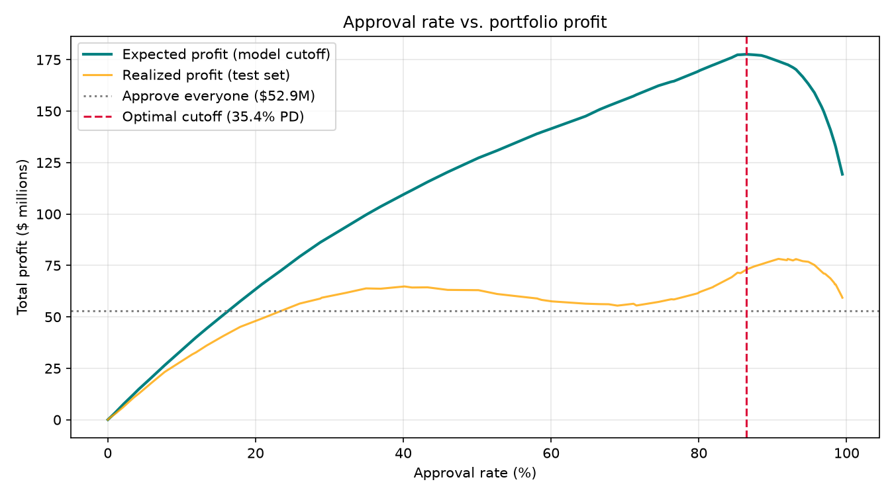

# Credit Risk Model — PD + Approval-Cutoff Decision Layer

A probability-of-default (PD) model on **2.26M LendingClub loans (2007–2018)** paired with an expected-profit decision layer that turns the model into an actual approve/decline rule. Trained on borrower attributes only — grade, sub-grade, and the lender's own interest rate are deliberately excluded, so the model competes against LendingClub's underwriting rather than copying it.

**Headline result on 319k held-out test loans (2016-07+):**

| Policy | Approval rate | Default rate | Realized profit |
| --- | ---: | ---: | ---: |
| Approve everyone | 100% | 20.1% | $52.9M |
| **Model cutoff (PD ≤ 35.4%)** | **86.4%** | **19.6%** | **$73.0M (+38%)** |

The model declines the riskiest ~14% of applicants and lifts realized portfolio profit by **$20M** over a blanket-approve policy, with a **6.4× decile lift** (decile-1 default 6.8% vs decile-10 43.5%) driving the discriminatory power. AUC on the calibrated model is 0.670.




**Stack:** PostgreSQL · psycopg3 (COPY-based bulk load) · scikit-learn · LightGBM · matplotlib · pytest · Docker

**Model metrics:**

| Model | AUC | KS | Brier |
| --- | ---: | ---: | ---: |
| Logistic Regression | 0.665 | 0.241 | 0.167 |
| LightGBM (uncalibrated) | 0.670 | 0.245 | 0.165 |
| **LightGBM (isotonic)** | **0.669** | **0.244** | **0.164** |

---

## 1. Business question

> If we approve every applicant whose predicted default probability is below a threshold *t*, what *t* maximizes expected profit — and what does that cost us in approval rate?

A good AUC is only useful once someone picks a cutoff and defends it. This project treats the cutoff as the deliverable: the model is a means to a decision, not an end.

## 2. Data

| Item | Detail |
| --- | --- |
| Source | Kaggle, [Lending Club Loan Data](https://www.kaggle.com/datasets/wordsforthewise/lending-club) — `accepted_2007_to_2018Q4.csv` |
| Grain | One row per funded loan |
| Raw size | 2,260,668 rows × 145 columns |
| After filtering to resolved outcomes (`Fully Paid`/`Charged Off`) | 1,303,305 rows |
| Target | `defaulted = 1` if `loan_status = 'Charged Off'`, else `0` |

The Kaggle snapshot is privacy-scrubbed and does **not** carry `fico_range_low` / `fico_range_high`, so the model relies on self-reported borrower attributes, revolving-credit telemetry, and derived features such as credit-history length. Download instructions live in `data/README.md`; the raw CSV is gitignored.

## 3. Pipeline

```
data/raw/loan.csv
      │  src/load_data.py       psycopg3 COPY FROM STDIN  (2.26M rows / ~27s)
      ▼
Postgres: loans_raw
      │  sql/01_build_target.sql   cast types, parse Mon-YYYY dates, label
      ▼
loans_labeled
      │  sql/02_features.sql       feature engineering + leakage-safe window
      ▼
features
      │  src/split.py              time-based split (train < 2015-01 ≤ valid < 2016-07 ≤ test)
      ▼
train / valid / test  ──► src/train.py    LogReg baseline + LightGBM + isotonic calibration
                                       └► reports/metrics.csv
                                       └► reports/test_predictions.parquet
                                       └► reports/model.joblib
                      ──► src/evaluate.py KS, Brier, decile table, calibration plot
                                       └► reports/evaluation.md
                                       └► reports/decile_table.csv
                                       └► reports/calibration.png
                      ──► src/cutoff.py   expected-profit sweep, chart
                                       └► reports/cutoff.png
                                       └► reports/cutoff_sweep.csv
```

### Load — Postgres COPY, not `pandas.to_sql`

`src/load_data.py` creates `loans_raw` with every column as `TEXT`, then streams the CSV through psycopg3's `cursor.copy()` context manager. 2.26M rows load in ~27 seconds; the equivalent chunked `to_sql` loop takes several minutes. Typing happens later in SQL, where column names and casts live together.

### Features — SQL does the work

`sql/02_features.sql` builds a leakage-safe feature set directly in Postgres:

| Feature | Source |
| --- | --- |
| `loan_amnt`, `funded_amnt`, `term_months`, `installment` | Cast from raw |
| `dti` (winsorized `[0, 60]`) | `LEAST(GREATEST(dti, 0), 60)` |
| `loan_to_income` | `loan_amnt / NULLIF(annual_inc, 0)` |
| `revol_util` | Strip `%`, cast to numeric |
| `emp_length_num` | Map `10+ years` → 10, `< 1 year` → 0, parse the rest |
| `credit_history_years` | `AGE(issue_d, earliest_cr_line)` in fractional years |
| `recent_inquiries` | `inq_last_6mths` |
| `state_prior_default_rate` | **Window function:** running default rate by state, strictly prior to this loan (`ROWS BETWEEN UNBOUNDED PRECEDING AND 1 PRECEDING`) |
| `purpose`, `home_ownership`, `addr_state` | Categorical passthroughs |

### Leakage guard

The following columns describe *outcomes*, not applications, and are refused by `src/train._assert_no_leakage` (see `src/config.LEAKAGE_COLS` for the full list):

`total_pymnt`, `total_rec_prncp`, `total_rec_int`, `recoveries`, `collection_recovery_fee`, `last_pymnt_amnt`, `last_pymnt_d`, `out_prncp`, every `hardship_*` / `settlement_*` column, plus a few more.

`grade`, `sub_grade`, and `int_rate` are *known at application time* but encode LendingClub's own model. They are dropped from the feature set (`src/config.NON_FEATURE_COLS`) to make this an honest "build your own score" exercise rather than a race to recover a published rate card. `int_rate` is still carried past the feature boundary for use in the profit calculation downstream.

### Split — by time, not randomly

Random splits leak macroeconomic conditions between folds and overstate performance. The pipeline splits on `issue_d`:

- **Train:** `issue_d < 2015-01-01` — 449,414 loans
- **Validation:** `2015-01-01 ≤ issue_d < 2016-07-01` — 534,515 loans
- **Test:** `issue_d ≥ 2016-07-01` — 319,376 loans

The validation set drives LightGBM early stopping and the isotonic calibrator.

### Calibration — `FrozenEstimator` + `CalibratedClassifierCV`

scikit-learn 1.6 deprecated `CalibratedClassifierCV(cv="prefit")` and removed it in 1.9. The modern pattern is `CalibratedClassifierCV(FrozenEstimator(model), method="isotonic")` fit on the held-out validation set — `FrozenEstimator` guarantees the base LightGBM is never refit.

## 4. Decision layer

Per-loan expected profit:

```
E[profit] = (1 - PD) · interest_earned − PD · (LGD · loan_amnt)
interest_earned = installment · term_months − loan_amnt   (exact amortized)
LGD assumed flat at 0.85 (see src/config.LGD)
```

The exact amortized interest comes straight from the servicer-published `installment` column. A naive `loan_amnt × rate × years` approximation nearly doubles total interest, because the principal declines each month on an amortizing loan — using it would make the cutoff rule meaningless.

`src/cutoff.py` sweeps thresholds across `0.02 ≤ t ≤ 0.60` and finds the `t` that maximises expected portfolio profit on the test set.

**Result:**

| Policy | Approvals | Default rate | Expected profit | Realized profit |
| --- | ---: | ---: | ---: | ---: |
| Approve everyone | 319,376 | 20.1% | — | $52.9M |
| **Model cutoff (PD ≤ 35.4%)** | **275,961** | **19.6%** | **$177.6M** | **$73.0M** |

The model declines the top-PD **~14%** of applicants, reducing the realized default rate by 0.5pp and lifting realized profit by **+38%** on the test window. The expected-profit figure sits above the realized figure because the LGD assumption (0.85) and the ignored prepayment effect both bias expectations high — the directional ranking of policies is what matters, not the absolute dollar level.

Beyond approve/decline, the natural extension is **risk-based pricing**: decile-10 loans at 43.5% realized default rate should carry a materially higher APR than decile-1 loans at 6.8%, which is how real consumer lenders actually use PD models.

## 5. Limitations

- **Reject inference.** LendingClub only publishes funded loans, so the model never sees declined applicants. Population drift between funded and all applicants is unmeasured.
- **No bureau score.** This Kaggle snapshot was privacy-scrubbed. A production model would have FICO; without it the ceiling on AUC is lower than for most published LendingClub analyses.
- **Flat LGD.** A 0.85 recovery-rate assumption; a real risk team would model LGD separately or run sensitivity across `[0.7, 0.85, 1.0]`. This drives the gap between expected and realized profit in the decision layer.
- **No prepayment or cost-of-funds modelling.** The profit math uses the scheduled amortization but assumes every non-defaulting loan runs to maturity and that funding is free.
- **Fairness not assessed.** A fair-lending analysis across `addr_state` and other protected proxies belongs in a separate project.

## 6. AI-assisted development note

An earlier draft of this repository was scaffolded by Gemini Flash from a prompt-style README. The current state is the result of a cleanup pass with Claude: fixing the leakage check (previously asserted on a column name that doesn't exist), replacing `pandas.to_sql` with `psycopg3.cursor.copy()`, updating the calibrator to use `FrozenEstimator` (the pre-1.6 `cv="prefit"` path is removed in sklearn 1.9), carrying `earliest_cr_line` and `inq_last_6mths` through the SQL so the engineered features actually survive to the model, and rewriting this README to describe what the code does rather than what the prompt originally asked for. Pipeline outputs (metrics, decile table, calibration plot, cutoff chart) are reproduced from a live run against the Kaggle CSV.

## 7. Reproduce

Requires Python ≥ 3.11, [uv](https://docs.astral.sh/uv/), and Docker.

```bash
git clone <repo> && cd credit-risk-model
cp .env.example .env
uv sync --extra dev
docker compose up -d db
# Place accepted_2007_to_2018Q4.csv at data/raw/loan.csv (see data/README.md).
make all     # data -> features -> train -> evaluate -> cutoff
make test    # 32 pytest cases
```

Individual stages: `make data`, `make features`, `make train`, `make evaluate`, `make cutoff`.

## 8. Repo layout

```
.
├── README.md
├── pyproject.toml          # uv-managed deps + pytest/ruff config
├── docker-compose.yml      # Postgres 16
├── Makefile                # make help lists every target
├── .env.example
├── data/
│   └── README.md           # Kaggle download instructions
├── sql/
│   ├── 01_build_target.sql
│   └── 02_features.sql
├── src/
│   ├── config.py           # paths, dates, LGD, leakage list
│   ├── load_data.py        # psycopg3 COPY from stdin
│   ├── build_features.py   # runs the SQL files
│   ├── split.py            # time-based train/valid/test
│   ├── train.py            # LogReg + LightGBM + isotonic calibration
│   ├── evaluate.py         # KS, Brier, decile table, calibration plot
│   └── cutoff.py           # expected-profit sweep
├── tests/                  # 32 pytest cases: split, cutoff, leakage, evaluate
└── reports/                # pipeline outputs (gitignored)
```
