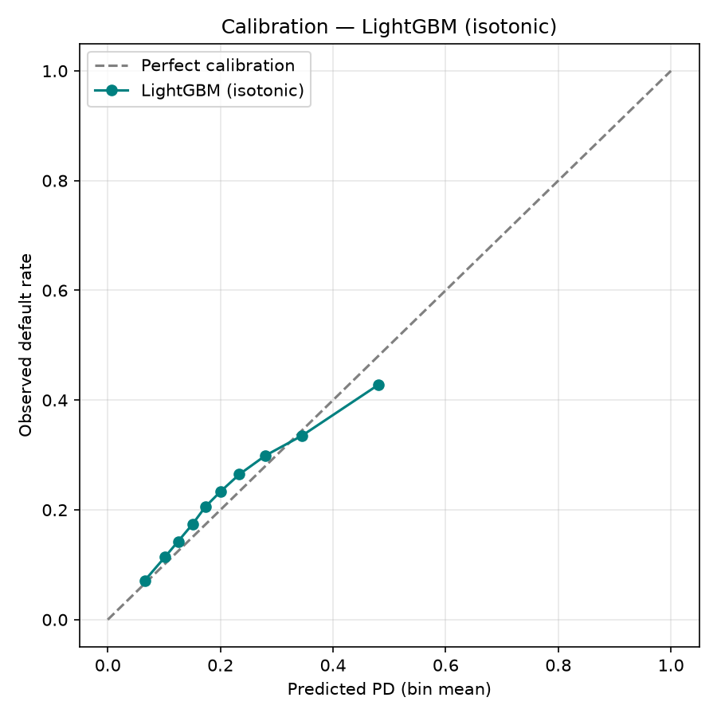

# Evaluation

| model | AUC | KS | Brier |
| --- | ---: | ---: | ---: |
| Logistic Regression | 0.6650 | 0.2407 | 0.1674 |
| LightGBM (uncalibrated) | 0.6695 | 0.2447 | 0.1653 |
| LightGBM (isotonic) | 0.6694 | 0.2441 | 0.1642 |

Decile lift (D10 / D1 default rate): **6.0x**

